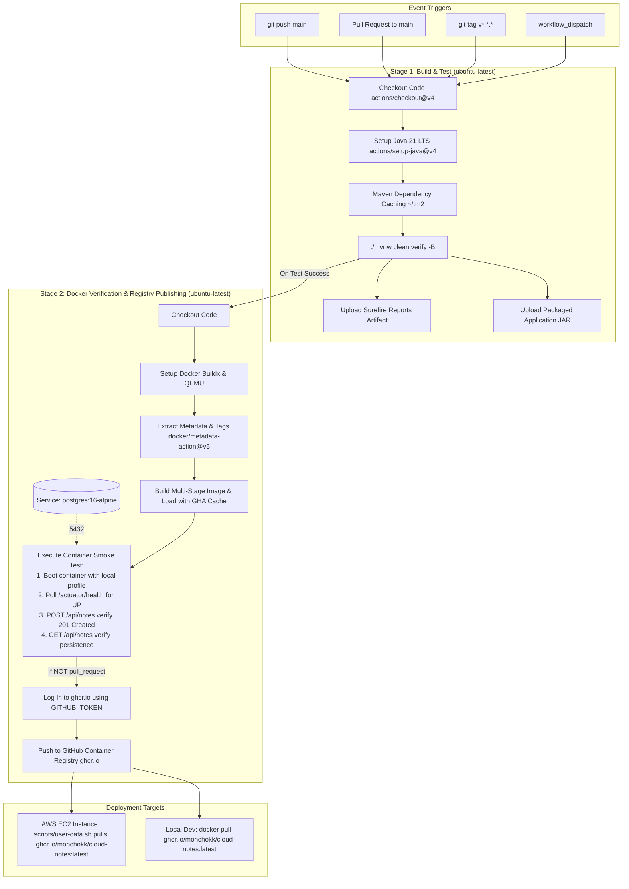

# 🔄 CloudNotes CI/CD Pipeline & Container Publishing

> Production-grade continuous integration, automated verification, containerization, and registry publishing specification for **CloudNotes**. WTC-88EXSGHH

---

## 1. Pipeline Overview

The CloudNotes CI/CD workflow is orchestrated via **GitHub Actions** ([`.github/workflows/ci-cd.yml`](../.github/workflows/ci-cd.yml)). It automates the complete lifecycle from code commit to container registry publishing:

1. **Continuous Integration (CI):** Validates code compilation, executes 17 unit and integration tests across web, service, and persistence layers, and archives artifacts.
2. **Container Verification:** Builds the production multi-stage Docker image and executes an end-to-end container smoke test against a live PostgreSQL 16 instance.
3. **Continuous Delivery / Registry Publishing (CD):** Pushes versioned, immutable Docker images to **GitHub Container Registry (GHCR)** (`ghcr.io/monchokk/cloud-notes`).

---

## 2. Pipeline Architecture Diagram



---

## 3. Workflow Trigger Matrix

| Event | Condition | Test Stage | Docker Smoke Test | GHCR Publish |
|---|---|:---:|:---:|:---:|
| `push` to `main` | Production branch commits | ✅ | ✅ | ✅ (`latest`, `sha-*`) |
| `pull_request` | PR targeting `main` | ✅ | ✅ | ❌ *(Protected from publishing)* |
| `push` tag `v*.*.*` | Release tags (e.g., `v1.0.0`) | ✅ | ✅ | ✅ (`1.0.0`, `1.0`, `v1.0.0`) |
| `workflow_dispatch` | Manual operator trigger | ✅ | ✅ | ✅ |

### Concurrency Management
```yaml
concurrency:
  group: ${{ github.workflow }}-${{ github.ref }}
  cancel-in-progress: ${{ github.event_name == 'pull_request' }}
```
When rapid commits are pushed to an open pull request, outdated in-flight workflow runs are automatically cancelled, saving runner minutes.

---

## 4. Pipeline Stages In-Depth

### Stage 1: Build, Lint & Automated Tests
- **Runtime:** Java 21 LTS (Temurin distribution) running on `ubuntu-latest`.
- **Dependency Caching:** Built-in Maven caching in `actions/setup-java@v4` hashes `pom.xml`, avoiding downloading dependencies on consecutive runs.
- **Verification Command:**
  ```bash
  ./mvnw clean verify -B
  ```
  Runs 17 test cases across:
  - `CloudNotesIntegrationTest`: End-to-end MockMvc tests against H2 in-memory persistence and Spring Boot Actuator health endpoints.
  - `NoteControllerTest`: Web MVC slice testing validating request payload schemas, validations, and HTTP response codes (200, 201, 204, 400, 404).
  - `NoteServiceTest`: Unit testing verifying business rules, entity mapping, and exception bubbling.
- **Artifacts Retained:**
  - `surefire-test-reports`: Test execution XML/HTML reports (14-day retention).
  - `cloudnotes-application-jar`: The standalone, executable Spring Boot JAR (7-day retention).

---

### Stage 2: Docker Verification, Live Smoke Test & Publishing

#### 1. GitHub Actions Cache (`type=gha`)
The Docker build utilizes GitHub Actions Cache backend:
```yaml
cache-from: type=gha
cache-to: type=gha,mode=max
```
Subsequent builds only rebuild layers whose files have changed, accelerating multi-stage image packaging.

#### 2. Live Container Smoke Test Invariant
Before any image is pushed to the container registry, the pipeline spins up the built image (`cloudnotes:test`) on the runner alongside an official `postgres:16-alpine` service container:
1. **Actuator Health Probe:** Polls `http://127.0.0.1:8080/actuator/health` until Spring Boot and the HikariCP database connection pool report `{"status":"UP"}`.
2. **API Data Invariant:** Sends an HTTP `POST /api/notes` request with a sample payload and asserts an HTTP `201 Created` status.
3. **Persistence Query:** Sends an HTTP `GET /api/notes` request and verifies the created note is retrieved from the database.

If any invariant fails, the runner dumps container logs, exits with code 1, and aborts image publishing.

#### 3. GitHub Container Registry (GHCR) Publishing
Images are published under the repository namespace:
```text
ghcr.io/monchokk/cloud-notes
```

Authentication is handled securely through the default `${{ secrets.GITHUB_TOKEN }}` with `packages: write` permissions, eliminating the need to store third-party credentials.

---

## 5. Image Tagging Strategy

Using `docker/metadata-action@v5`, images published to GHCR are tagged with multiple conventions:

| Tag Format | Example | Purpose |
|---|---|---|
| `latest` | `ghcr.io/monchokk/cloud-notes:latest` | Default rolling tag for the latest `main` commit |
| `sha-<short>` | `ghcr.io/monchokk/cloud-notes:sha-a8566f5` | Immutable commit reference for reproducible deployments |
| `<semver>` | `ghcr.io/monchokk/cloud-notes:1.0.0` | Production release milestone tag |
| `<major>.<minor>` | `ghcr.io/monchokk/cloud-notes:1.0` | Minor version rolling pointer |

---

## 6. AWS EC2 Cloud Deployment Integration

With Phase 5 active, the automated EC2 bootstrapping script ([`scripts/user-data.sh`](../scripts/user-data.sh)) pulls the prebuilt image directly from GHCR:

```bash
docker pull ghcr.io/monchokk/cloud-notes:latest
docker run -d \
  --name cloudnotes-app \
  --restart always \
  -p 80:8080 \
  -p 8080:8080 \
  --env-file .env \
  ghcr.io/monchokk/cloud-notes:latest
```

### Benefits of Prebuilt Container Images in Cloud Deployments:
1. **Bootstrapping Speed:** EC2 instances launch and serve traffic in **< 30 seconds** (skipping Java SDK installation, Maven package compilation, and repository cloning).
2. **Resource Efficiency:** Compute instances do not waste CPU or RAM compiling code in production.
3. **Artifact Immutability:** The exact container image verified during CI testing is what runs in production.

> [!NOTE]
> **GHCR Package Visibility:**
> To allow the EC2 instance or external users to pull the image without authentication, navigate to your GitHub Profile &rarr; **Packages** &rarr; **cloud-notes** &rarr; **Package Settings** &rarr; Change package visibility to **Public**.

---

## 7. Local Simulation & Verification

Developers can simulate the entire CI pipeline locally before pushing:

### 1. Run Test Suite Locally
```bash
./mvnw clean verify
```

### 2. Build Docker Container Locally
```bash
docker build -t cloudnotes:local .
```

### 3. Verify Container with Docker Compose
```bash
docker compose up -d --build
curl -f http://localhost:8080/actuator/health
docker compose down
```
