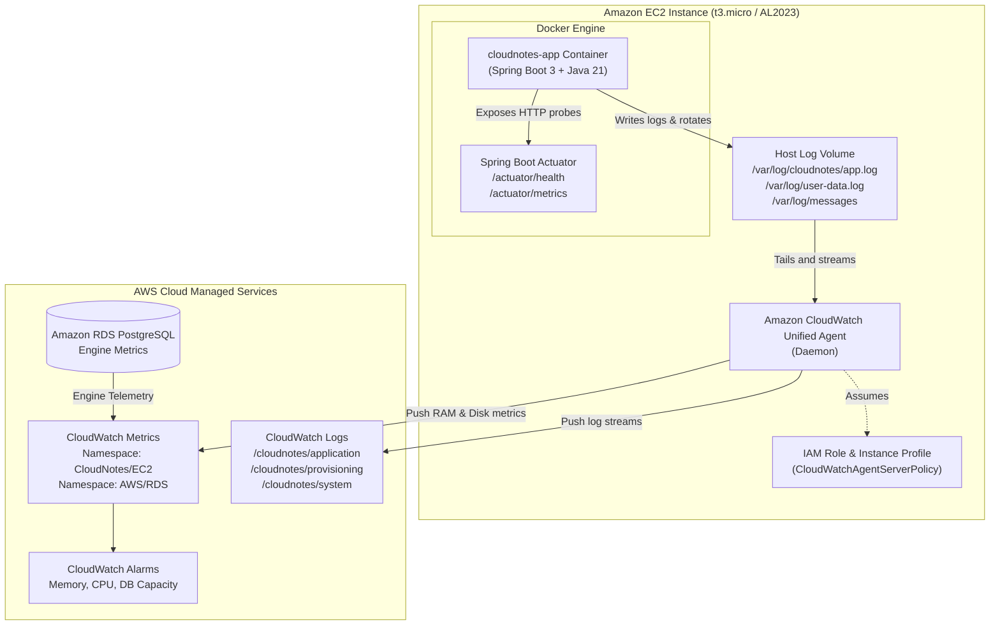

# 📊 CloudNotes Monitoring & Observability Guide

## 1. Overview & Architecture

Observability is a core pillar of the **CloudNotes** cloud architecture. The system integrates multi-layered telemetry spanning the application runtime, database layer, operating system, and container lifecycle.



### Key Observability Principles:
1. **Zero Credential Exposure**: Telemetry streaming requires no static AWS credentials or API keys; the EC2 instance assumes an IAM Instance Profile (`cloudnotes-ec2-instance-profile`) with least-privilege `CloudWatchAgentServerPolicy`.
2. **Decoupled Log Shipping**: The Spring Boot application writes both to container `stdout` (for immediate local `docker logs` visibility) and to a persistent host-mounted volume (`/var/log/cloudnotes/app.log`), allowing the CloudWatch Unified Agent to stream logs without putting telemetry network overhead inside the application thread pool.
3. **Deep Host & Container Telemetry**: Standard AWS EC2 CloudWatch metrics do not report OS-level memory or disk consumption. The Unified Agent bridges this gap by reporting active RAM and disk space utilization under the custom namespace `CloudNotes/EC2`.

---

## 2. CloudWatch Unified Agent Configuration

The AWS CloudWatch Unified Agent is installed automatically during instance bootstrapping via [scripts/user-data.sh](file:///c:/Users/KABELO%20PC/practise_projects/cloud-notes/scripts/user-data.sh).

### Configuration Schema (`/opt/aws/amazon-cloudwatch-agent/etc/amazon-cloudwatch-agent.json`)

```json
{
  "agent": {
    "metrics_collection_interval": 60,
    "run_as_user": "root"
  },
  "logs": {
    "logs_collected": {
      "files": {
        "collect_list": [
          {
            "file_path": "/var/log/cloudnotes/app.log",
            "log_group_name": "/cloudnotes/application",
            "log_stream_name": "{instance_id}-app",
            "timestamp_format": "%Y-%m-%d %H:%M:%S.%f",
            "auto_removal": false
          },
          {
            "file_path": "/var/log/user-data.log",
            "log_group_name": "/cloudnotes/provisioning",
            "log_stream_name": "{instance_id}-user-data",
            "timestamp_format": "%Y-%m-%d %H:%M:%S",
            "auto_removal": false
          },
          {
            "file_path": "/var/log/messages",
            "log_group_name": "/cloudnotes/system",
            "log_stream_name": "{instance_id}-system",
            "timestamp_format": "%b %d %H:%M:%S"
          }
        ]
      }
    }
  },
  "metrics": {
    "namespace": "CloudNotes/EC2",
    "metrics_collected": {
      "mem": {
        "measurement": [
          "mem_used_percent"
        ],
        "metrics_collection_interval": 60
      },
      "disk": {
        "measurement": [
          "used_percent"
        ],
        "metrics_collection_interval": 60,
        "resources": [
          "/"
        ]
      }
    },
    "append_dimensions": {
      "InstanceId": "${aws:InstanceId}"
    }
  }
}
```

### Log Streams Reference:

| Log Group | Log Stream Source | Retention Recommendation | Purpose |
|---|---|---|---|
| `/cloudnotes/application` | `/var/log/cloudnotes/app.log` | 14 – 30 Days | Application logs, Spring Data JPA operations, errors, and access events. |
| `/cloudnotes/provisioning` | `/var/log/user-data.log` | 7 Days | EC2 cloud-init provisioning, Docker pull/build, and startup diagnostics. |
| `/cloudnotes/system` | `/var/log/messages` | 7 Days | Linux OS kernel messages, Docker daemon lifecycle, out-of-memory kill signals. |

---

## 3. Spring Boot Actuator Telemetry

CloudNotes exposes production-grade health and metrics probes via Spring Boot Actuator:

### 3.1 Health Probes (`/actuator/health`)

```bash
curl -s http://<EC2-PUBLIC-IP>:8080/actuator/health | jq .
```

Sample output:
```json
{
  "status": "UP",
  "components": {
    "db": {
      "status": "UP",
      "details": {
        "database": "PostgreSQL",
        "validationQuery": "isValid()"
      }
    },
    "diskSpace": {
      "status": "UP",
      "details": {
        "total": 21474836480,
        "free": 18253611008,
        "threshold": 10485760
      }
    },
    "ping": {
      "status": "UP"
    }
  },
  "groups": [
    "liveness",
    "readiness"
  ]
}
```

### 3.2 Metrics Endpoint (`/actuator/metrics`)

Inspect specific application metrics directly:

```bash
# Query active HikariCP connection pool status
curl -s http://<EC2-PUBLIC-IP>:8080/actuator/metrics/hikaricp.connections.active | jq .

# Query HTTP request counts and response latency
curl -s http://<EC2-PUBLIC-IP>:8080/actuator/metrics/http.server.requests | jq .

# Query JVM heap memory consumption
curl -s http://<EC2-PUBLIC-IP>:8080/actuator/metrics/jvm.memory.used | jq .
```

---

## 4. CloudWatch Alarms & Monitoring Matrix

Establish the following alarms in AWS CloudWatch to ensure proactive alerting:

| Metric Name | Namespace | Threshold | Evaluation Period | Action |
|---|---|---|---|---|
| `mem_used_percent` | `CloudNotes/EC2` | `> 85%` | 2 consecutive 60s periods | Trigger SNS Alert (OOM Risk) |
| `used_percent` (Disk) | `CloudNotes/EC2` | `> 80%` | 3 consecutive 60s periods | Trigger SNS Alert (Disk Cleanup needed) |
| `CPUUtilization` | `AWS/EC2` | `> 85%` | 5 minutes | Scale compute or investigate thread lock |
| `CPUUtilization` | `AWS/RDS` | `> 80%` | 5 minutes | Slow query or missing index triage |
| `FreeStorageSpace` | `AWS/RDS` | `< 2 GB` | 1 minute | Enable storage auto-scaling / cleanup |
| `DatabaseConnections`| `AWS/RDS` | `> 80` (of max pool) | 2 consecutive minutes | Leak inspection or pool resize |

---

## 5. CloudWatch Logs Insights Query Cookbook

Use the following queries in the **AWS CloudWatch Console** (`Logs` > `Logs Insights`) targeting `/cloudnotes/application`:

### 5.1 Find All Application Exceptions & Stack Traces
```sql
fields @timestamp, @message
| filter @message like /ERROR/ or @message like /Exception/ or @message like /WARN/
| sort @timestamp desc
| limit 50
```

### 5.2 Analyze HTTP Request Activity
```sql
fields @timestamp, @message
| filter @message like /NoteController/ or @message like /NoteService/
| parse @message "* - * *" as level, operation, details
| stats count(*) by level
```

### 5.3 Detect Database Connection Failures
```sql
fields @timestamp, @message
| filter @message like /HikariPool/ or @message like /Connection refused/ or @message like /Communications link failure/
| sort @timestamp desc
```

### 5.4 Audit Note Creation and Deletion Events
```sql
fields @timestamp, @message
| filter @message like /POST/ or @message like /DELETE/
| sort @timestamp desc
| limit 100
```

---

## 6. Operational Runbook & Incident Response

### Incident 1: Application Health Probe Returns `DOWN` (503 Service Unavailable)

**Symptom**: `curl http://<EC2-PUBLIC-IP>:8080/actuator/health` returns HTTP 503 or `{"status": "DOWN"}`.

**Triage Steps**:
1. Connect to EC2 instance via SSH:
   ```bash
   ssh -i your-key.pem ec2-user@<EC2-PUBLIC-IP>
   ```
2. Verify Docker container status:
   ```bash
   docker ps -a
   ```
   - If container exited with status `137`: Process was killed by Linux OOM killer.
   - If container is `restarting`: Check exit codes and application stack trace.
3. Check container logs:
   ```bash
   docker logs --tail 100 cloudnotes-app
   ```
4. Verify RDS PostgreSQL connectivity from the instance:
   ```bash
   # Test TCP connection to private database endpoint
   nc -zv <RDS-ENDPOINT> 5432
   ```
5. If the database component is failing (`"db": {"status": "DOWN"}`), verify the database credentials in `/opt/cloudnotes/.env` match the RDS instance master password.

**Remediation**:
```bash
# Restart container
docker restart cloudnotes-app

# Monitor real-time logs
docker logs -f cloudnotes-app
```

---

### Incident 2: Out of Memory (OOM) or Container Exit Code 137

**Symptom**: The container suddenly stops and restarts. `dmesg` reports `Out of memory: Kill process`.

**Triage Steps**:
1. Inspect CloudWatch memory metric (`CloudNotes/EC2 -> mem_used_percent`).
2. Inspect the current JVM heap configuration inside `/opt/cloudnotes/.env`:
   ```bash
   cat /opt/cloudnotes/.env | grep JAVA_OPTS
   ```

**Remediation**:
Adjust the JVM RAM percentage to ensure the OS and CloudWatch Agent retain sufficient headroom:
```bash
cd /opt/cloudnotes
# Adjust MaxRAMPercentage to 65% on memory-constrained t3.micro instances
sed -i 's/MaxRAMPercentage=75.0/MaxRAMPercentage=65.0/g' .env
docker restart cloudnotes-app
```

---

### Incident 3: Instance Bootstrapping Failure (App Unreachable on First Launch)

**Symptom**: After running `deploy-aws.ps1`, the public IP does not respond on port 80 or 8080 after 3 minutes.

**Triage Steps**:
1. Inspect the provisioning log streamed to CloudWatch Log Group `/cloudnotes/provisioning` (or read locally):
   ```bash
   cat /var/log/user-data.log | grep -i "error"
   ```
2. Verify CloudWatch agent service status:
   ```bash
   systemctl status amazon-cloudwatch-agent
   ```
3. Test CloudWatch Agent log output:
   ```bash
   tail -n 50 /opt/aws/amazon-cloudwatch-agent/logs/amazon-cloudwatch-agent.log
   ```

---

## 7. Post-Deployment Verification Checklist

Execute this verification checklist after every deployment:

- [ ] **1. Public Application Reachability**:
  - `curl -I http://<EC2-PUBLIC-IP>` returns `HTTP/1.1 200 OK`.
- [ ] **2. Health Probes Verification**:
  - `curl -s http://<EC2-PUBLIC-IP>:8080/actuator/health` returns `"status":"UP"` with `"db":{"status":"UP"}`.
- [ ] **3. Metrics Exposure Verification**:
  - `curl -s http://<EC2-PUBLIC-IP>:8080/actuator/metrics` returns list of published metrics.
- [ ] **4. CloudWatch Log Group Verification**:
  - Using AWS CLI:
    ```bash
    aws logs describe-log-streams --log-group-name "/cloudnotes/application" --region eu-west-1
    ```
    Confirm recent log streams exist with names matching `<instance-id>-app`.
- [ ] **5. CloudWatch Custom Metrics Ingestion**:
  - Using AWS CLI:
    ```bash
    aws cloudwatch list-metrics --namespace "CloudNotes/EC2" --region eu-west-1
    ```
    Confirm metrics `mem_used_percent` and `used_percent` are actively reporting.
- [ ] **6. Persistence Verification**:
  - Create a test note via UI or API.
  - Restart the container (`docker restart cloudnotes-app`).
  - Refresh the UI; verify the note persists cleanly from Amazon RDS PostgreSQL.
