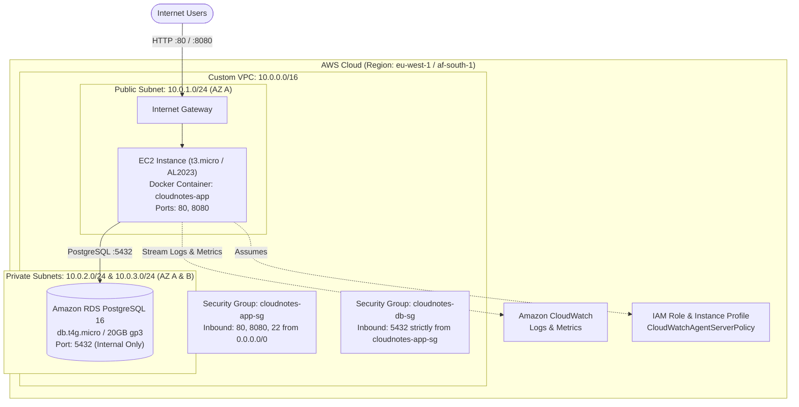

# 🌍 CloudNotes Terraform Infrastructure as Code (IaC) Guide

## 1. Overview & Cloud Architecture

This guide details the declarative provisioning of the complete **CloudNotes** AWS cloud infrastructure using **Terraform (IaC)**, conforming strictly to the architecture defined in [docs/architecture.md](architecture.md).



---

## 2. Terraform File Responsibilities

All Terraform configuration files are organized in the [`terraform/`](../terraform/) directory with modular separations of concern:

| File | Responsibility |
| :--- | :--- |
| [`main.tf`](../terraform/main.tf) | Configures the Terraform block (`required_version >= 1.5.0`), required provider `hashicorp/aws (~> 5.0)`, and the default provider configuration with global tagging. |
| [`variables.tf`](../terraform/variables.tf) | Declares all customizable input variables with type specifications, default values, and documentation descriptions. |
| [`network.tf`](../terraform/network.tf) | Provisions the network topology: VPC, Internet Gateway, public subnet, private subnets across 2 Availability Zones, and route tables. |
| [`security.tf`](../terraform/security.tf) | Configures firewall rules (EC2 application SG and RDS private SG) and IAM security (EC2 IAM role, CloudWatch policy attachment, instance profile). |
| [`compute.tf`](../terraform/compute.tf) | Locates the latest Amazon Linux 2023 AMI, renders the dynamic user-data bootstrap template, and launches the EC2 application instance. |
| [`rds.tf`](../terraform/rds.tf) | Provisions the multi-AZ DB Subnet Group and the private PostgreSQL 16 RDS instance. |
| [`outputs.tf`](../terraform/outputs.tf) | Exposes essential operational attributes: VPC ID, public IP/DNS, application URLs, health probe endpoints, and private RDS address. |
| [`user-data.sh.tftpl`](../terraform/user-data.sh.tftpl) | Template bootstrap script executed on EC2 boot; installs Docker, configures the CloudWatch Unified Agent, writes the `.env` file with RDS credentials, and runs the container. |
| [`terraform.tfvars.example`](../terraform/terraform.tfvars.example) | Example input values file for local development and customized deployments. |

---

## 3. Input Variables & Outputs

### 3.1 Input Variables

| Variable | Type | Default | Description |
| :--- | :--- | :--- | :--- |
| `aws_region` | `string` | `"eu-west-1"` | AWS Region for resource provisioning. |
| `project_name` | `string` | `"cloudnotes"` | Prefix applied to all AWS resource names. |
| `environment` | `string` | `"prod"` | Environment tag (e.g. prod, staging, dev). |
| `vpc_cidr` | `string` | `"10.0.0.0/16"` | CIDR block for the custom VPC. |
| `public_subnet_cidr` | `string` | `"10.0.1.0/24"` | CIDR block for the public subnet (AZ A). |
| `private_subnet_1_cidr`| `string` | `"10.0.2.0/24"` | CIDR block for private subnet 1 (AZ A). |
| `private_subnet_2_cidr`| `string` | `"10.0.3.0/24"` | CIDR block for private subnet 2 (AZ B). |
| `instance_type` | `string` | `"t3.micro"` | EC2 instance size. |
| `key_name` | `string` | `null` | Optional EC2 key pair for SSH access. |
| `container_image` | `string` | `"ghcr.io/monchokk/cloud-notes:latest"` | Image pulled from GitHub Container Registry. |
| `app_port` | `number` | `8080` | Spring Boot container listening port. |
| `db_instance_class` | `string` | `"db.t4g.micro"` | RDS PostgreSQL instance class. |
| `db_allocated_storage`| `number` | `20` | Storage allocation in GB (gp3). |
| `db_engine_version` | `string` | `"16.3"` | PostgreSQL engine version. |
| `db_name` | `string` | `"cloudnotes"` | Database schema name. |
| `db_username` | `string` | `"cloudnotes"` | Master database username. |
| `db_password` | `string` | (Sensitive) | Master database password. |
| `tags` | `map(string)`| `{ Project = "CloudNotes", ManagedBy = "Terraform" }` | Common resource tags. |

### 3.2 Key Outputs

| Output Name | Description | Example / Format |
| :--- | :--- | :--- |
| `app_url` | Primary web UI URL (Port 80 via Docker) | `http://<ec2-public-ip>` |
| `app_direct_url` | Direct application URL (Port 8080) | `http://<ec2-public-ip>:8080` |
| `health_check_url` | Actuator health endpoint | `http://<ec2-public-ip>:8080/actuator/health` |
| `rds_address` | Private RDS PostgreSQL address | `cloudnotes-postgres-db.xxxx.<region>.rds.amazonaws.com` |
| `vpc_id` | Custom VPC ID | `vpc-0123456789abcdef0` |

---

## 4. Local Validation & Verification

Before executing any deployment against AWS, run the standard Terraform validation workflow from the `terraform/` directory:

```bash
cd terraform

# 1. Verify code formatting conforms to HashiCorp standard style
terraform fmt -check -recursive

# 2. Initialize provider plugins without remote backend state
terraform init -backend=false

# 3. Validate configuration syntax, schema, and internal consistency
terraform validate
```

Expected output:
```text
Success! The configuration is valid.
```

---

## 5. Security Considerations

1. **Strict Database Network Isolation:**
   - The PostgreSQL RDS instance is configured with `publicly_accessible = false` and deployed inside private subnets (`10.0.2.0/24` and `10.0.3.0/24`).
   - Private subnets have **no route** to the Internet Gateway, eliminating external attack vectors.
2. **Least-Privilege Security Group Ingress:**
   - The database security group (`cloudnotes-db-sg`) allows ingress on port `5432` **strictly** from the EC2 application security group (`cloudnotes-app-sg`). No CIDR-based public ingress is allowed.
3. **IAM Least-Privilege Role:**
   - The EC2 instance assumes an IAM role with only `CloudWatchAgentServerPolicy`, granting strictly the necessary permissions to transmit logs and system performance metrics to CloudWatch.
4. **Credential Management:**
   - `db_password` is flagged with `sensitive = true` in Terraform, preventing cleartext leakage into terminal logs and CI/CD console output.

---

## 6. Resource Costs & Teardown

### 6.1 Estimated Monthly Cost Breakdown

| Component | AWS Resource | Monthly Estimate (eu-west-1) |
| :--- | :--- | :--- |
| **Compute** | EC2 `t3.micro` (730 hrs) | ~\$7.50 *(Free-tier eligible for 1st year)* |
| **Database** | RDS `db.t4g.micro` (Single-AZ) | ~\$11.50 |
| **Storage** | 20 GB gp3 RDS Storage | ~\$2.30 |
| **Networking** | VPC, Subnets, Route Tables, IGW | \$0.00 (Free) |
| **Monitoring** | CloudWatch Metrics & Logs | \$0.00 *(Within AWS Free Tier)* |
| **Total** | | **~\$21.30 / month** |

### 6.2 Infrastructure Teardown

To avoid incurring ongoing cloud compute and database charges, always destroy provisioned infrastructure when testing concludes:

```bash
terraform destroy -auto-approve
```

---

## 7. Limitations & Compliance Under R0 Budget Constraint

The **R0 budget constraint** mandates zero unnecessary cloud spend:
- **Zero Incurred Cost Guarantee:** Terraform allows 100% complete syntactic, schema, and dependency validation locally (`terraform fmt`, `terraform init -backend=false`, `terraform validate`) without creating active billable resources in AWS.
- **Never Run `apply` Unattended:** Avoid running `terraform apply` on long-running sandbox accounts unless actively conducting live verification.
- **Immediate Teardown:** Whenever a live deployment is executed, immediately follow up with `terraform destroy` or use the local Docker Compose / Dev H2 in-memory profile (`SPRING_PROFILES_ACTIVE=dev`) for zero-cost testing.

